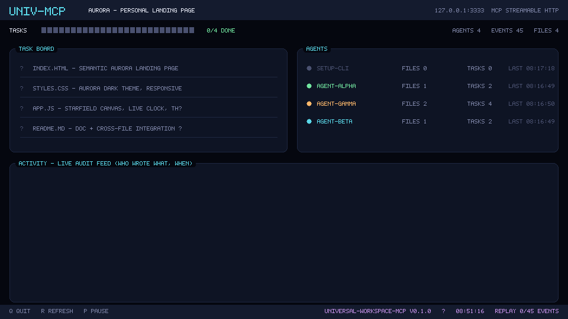
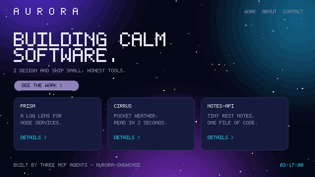
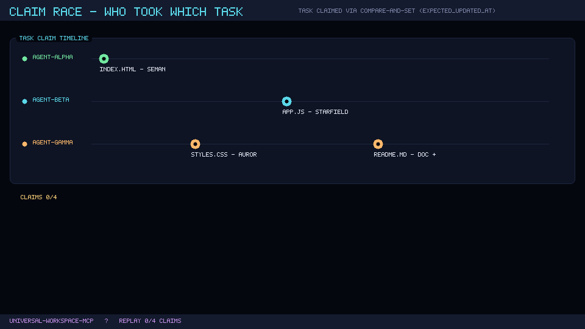
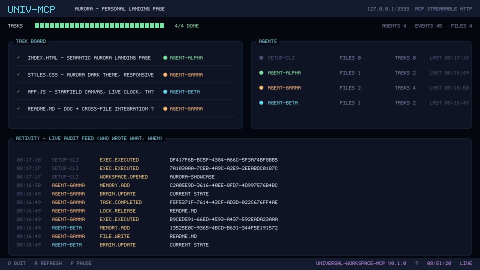
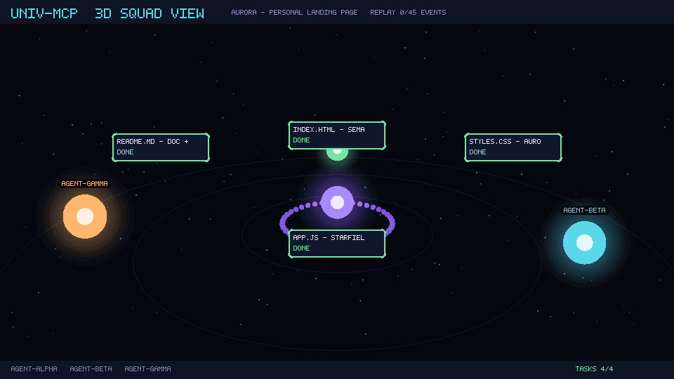

# Universal Workspace MCP

A remote, persistent, multi-agent **coding workspace** exposed through the standard **MCP Streamable HTTP** protocol. Any MCP-compatible agent — OpenCode, Claude Code, Codex CLI — connects to one HTTPS URL and works *inside* this server: files, project memory (`Brain.md`), plans/tasks, outputs, logs and an audit trail all live on this machine, never on the agent's device.

- **Server is the source of truth.** Agents provide reasoning; this workspace provides persistence and execution.
- **Multi-project, shared access (Option 2)** with an Option 3-ready schema (teams/private workspaces) — see `docs/ARCHITECTURE.md`.
- **Restricted remote execution** — safety denylist, workspace-jailed cwd, timeouts, concurrency caps. No unrestricted shell is exposed.
- **47 MCP tools + 6 resources + 5 prompts**, all behind per-workspace roles and bearer tokens.
- **Runs on a phone** — this whole thing was built and is running on an Android/Termux host.

### Watch it happen — 3 agents, 1 workspace, ~11 seconds



Live audit feed of a real build: who claimed which task, who wrote which file, when.

## 0. Status

Everything in Phases 1–7 is implemented and tested on this device:

| Area | Status |
|---|---|
| MCP Streamable HTTP server, health, auth (bearer + pepper) | ✅ |
| Workspaces, filesystem (atomic writes, hashes, locks), git init | ✅ |
| Brain.md + structured memory + decision records | ✅ |
| Plans/tasks with subtasks; auto-rendered PLAN.md | ✅ |
| Restricted execution engine + audit | ✅ |
| Agents/sessions + file locking + conflict detection | ✅ |
| Outputs/artifacts + export bundles | ✅ |
| 31 automated tests (unit + end-to-end) | ✅ |
| Backup & watchdog scripts | ✅ |
| Public HTTPS tunnel | ⚠️ scripts ready — **you** must log in once (see §6.4) |

A demo workspace `smoke-test` exists (created by the end-to-end smoke run). Archive it any time with the `workspace_delete` MCP tool (`confirm_slug=smoke-test`) or keep it to poke at.

## 1. Layout

```
~/UNIVERSAL-MCP/
├── src/            # TypeScript source (server, core, tools, resources, prompts)
├── dist/           # built output (npm run build)
├── data/           # ALL state — gitignored
│   ├── database.sqlite[-wal|-shm]
│   ├── workspaces/<slug>/   # Brain.md, PROJECT.md, PLAN.md, outputs/, logs/, .git, your files
│   ├── backups/             # db snapshots + workspace tarballs
│   ├── tmp/                 # atomic-write scratch
│   └── server.log
├── docs/ARCHITECTURE.md     # full design document
├── scripts/                 # start/stop/backup/watchdog/termux-boot/smoke
└── tests/                   # vitest unit + end-to-end integration
```

## 2. Quick start

```bash
cd ~/UNIVERSAL-MCP
npm install          # once
npm run setup        # once: writes .env (fresh TOKEN_PEPPER), seeds owner + admin token
npm run build
npm start            # http://127.0.0.1:3333/mcp   (Ctrl-C to stop)
```

`npm run setup` prints an **admin token once**. Save it — it is what your agents will use. Mint more any time:

```bash
npm run mint-token -- --name opencode-phone --agent opencode-phone
npm run mint-token -- --name readonly --agent viewerbot --scopes workspace:read,files:read
npm run list-tokens
npm run revoke-token -- <token-id>   # note the double dash for npm arg passing
```

Health check: `curl http://127.0.0.1:3333/health` → `{"status":"ok",...}`

## 3. Connecting an agent

Give the agent the URL and its own token. The agent then calls `workspace_open` first.

### OpenCode — `~/.config/opencode/opencode.json`
```jsonc
{
  "mcp": {
    "universal-mcp": {
      "type": "remote",
      "url": "https://mcp.<your-domain>/mcp",
      "headers": { "Authorization": "Bearer umcp_..." },
      "enabled": true
    }
  }
}
```

### Claude Code
```bash
claude mcp add --transport http universal-mcp \
  https://mcp.<your-domain>/mcp \
  --header "Authorization: Bearer umcp_..."
```

### Codex CLI — `~/.codex/config.toml`
```toml
[mcp_servers.universal-mcp]
url = "https://mcp.<your-domain>/mcp"
bearer_token_env_var = "UMCP_TOKEN"   # export UMCP_TOKEN=umcp_...
```

### Master instruction block (paste as the agent's first message / system prompt)
```text
Connect to my MCP server (universal-mcp). Workspace: XCOMB.

IMPORTANT:
1. All project files must be stored in the MCP workspace.
2. Read existing project memory before coding (brain_read, memory_search).
3. Open or create a plan and tasks before making changes (plan_create/task_create).
4. Use MCP file tools for all project file operations — never your local filesystem.
5. Execute commands through MCP terminal_* tools — never your native shell for project work.
6. Save all outputs and logs in the MCP workspace (outputs/, logs/).
7. Update project memory after completing work (brain_update / memory_add).
8. Never silently create a separate local project.
9. Pass expected_hash on writes; on HASH_CONFLICT re-read and retry.
10. Wait for my approval after presenting the plan, before editing code.
```

The MCP `initialize` response also carries `instructions` so compliant clients see the workspace rules automatically.

## 4. Tools (47)

**Workspace** — `workspace_create` `workspace_list` `workspace_open` `workspace_switch` `workspace_info` `workspace_delete`
**Files** — `file_read` `file_write` `file_edit` `file_list` `file_search` `file_move` `file_delete`
**Brain/Memory** — `brain_read` `brain_update` `memory_add` `memory_read` `memory_update` `memory_search` `memory_list` `decision_record`
**Planning** — `plan_create` `plan_read` `plan_update` `plan_list` `task_create` `task_update` `task_complete` `task_list` `project_status`
**Execution** — `terminal_execute` `terminal_output` `terminal_status` `terminal_stop`
**Agents/Sessions** — `agent_register` `agent_list` `session_create` `session_list` `session_status` `session_history`
**Outputs** — `output_save` `output_list` `output_read` `output_export`
**Concurrency** — `lock_acquire` `lock_release` `lock_list`

**Resources** — `workspace://current` · `workspace://current/brain` · `workspace://current/plan` · `workspace://current/tasks` · `workspace://current/activity` · `workspace://current/files/{path}`
**Prompts** — `coding_session_start` · `project_analysis` · `implementation_plan` · `code_review` · `session_handover`

Every mutating tool is audit-logged (`events` table) with agent + session identity.

## 5. Security model (short)

- **Auth**: `Bearer umcp_<random>` per agent. Stored as `SHA-256(pepper + token)`; pepper lives only in `.env` (mode 600). Tokens shown once at mint time.
- **Authorization**: per-workspace membership + roles (`viewer → editor → admin → owner`), each expanding scopes; token scopes can only *narrow* role scopes. `private` workspaces are owner-only. Server binds **loopback only** — public reach happens exclusively through your tunnel.
- **Rate limit**: 120 req/min per token (fixed window).
- **Path safety**: all file paths jailed to the workspace root (symlink-safe); reserved entries (`Brain.md`, `PLAN.md`, `PROJECT.md`, `outputs/`, `logs/`) are immutable via file tools.
- **Execution**: `EXEC_MODE` — `restricted` (default; denylist of catastrophic commands, cwd jail, 5 concurrent processes, output caps) or `allowlist` (only listed command prefixes) or `disabled`. No Docker on Termux — this is the honest ceiling. Build tools freely; system taming is not available from agents by design.
- **Concurrency**: atomic rename writes; `expected_hash` compare-and-swap on writes; TTL file locks; PLAN/tasks use compare-and-set on `updated_at`.

### Honest limitations (know these)

- **Termux is not guaranteed 24×7.** Phone off / no network / Android process death ⇒ server down. Wake-lock + battery-optimization exemption + Termux:Boot + `scripts/watchdog.sh` mitigate, never eliminate. For real 24×7, the same code deploys to a VPS unchanged.
- **Restart = new transport sessions.** MCP sessions after a restart are `orphaned`; agents must re-`initialize` (the client handles this) and re-`workspace_open`.
- **Terminal is not a sandbox** — it runs as your Termux UID. Secrets must not live in Termux home; tokens are hashed but host access is host access.
- A token leaks ⇒ full access it was granted. Mint one token per agent, revoke on suspicion.

## 6. Operations

### 6.1 tmux (already installed)
```bash
bash scripts/start.sh     # build + start 'umcp' tmux session + wake-lock
bash scripts/stop.sh
tmux attach -t umcp
```

### 6.2 Backup
```bash
bash scripts/backup.sh          # VACUUM INTO db snapshot + workspaces tarball, keep 14
```
**Restore**: stop server → `rm -rf data/workspaces data/database.sqlite*` → untar newest `data/backups/workspaces-*.tar.gz` → copy `db-*.sqlite` back as `data/database.sqlite` → `npm start`.

### 6.3 Watchdog (every 60 s)
Run from cron or a Termux:Boot loop:
```bash
bash scripts/watchdog.sh        # health check; restarts tmux session if down
```
Plus an external monitor (UptimeRobot/healthchecks.io) on `https://mcp.<your-domain>/health`.

### 6.4 Public URL via Cloudflare named tunnel (your one-time step)
```bash
cloudflared tunnel login                      # browser auth, once
cloudflared tunnel create umcp
cloudflared tunnel route dns umcp mcp.<your-domain>
# ~/.cloudflared/config.yml:
#   tunnel: umcp
#   credentials-file: /data/data/com.termux/files/home/.cloudflared/<TUNNEL_ID>.json
#   ingress:
#     - hostname: mcp.<your-domain>
#       service: http://127.0.0.1:3333
#     - service: http_status:404
cloudflared tunnel run umcp     # or a 'umcp-tunnel' tmux session
```
Then paste `https://mcp.<your-domain>/mcp` into your agents. **A public URL is not public access** — every request still requires a bearer token.

Quick but throwaway alternative: `cloudflared tunnel --url http://127.0.0.1:3333` (URL changes each run). Strongest privacy posture: Tailscale instead of any tunnel.

### 6.5 Termux:Boot (survive reboots)
```bash
mkdir -p ~/.termux/boot
cp scripts/termux-boot.sh ~/.termux/boot/start-umcp.sh
chmod +x ~/.termux/boot/start-umcp.sh
```
Plus: enable *Termux:Boot* and grant *Ignore battery optimizations* to Termux in Android settings.

### 6.6 Tests & compatibility
```bash
npm test                # 31 tests: paths, policy, brain sections, full HTTP+MCP workflow
npx tsx scripts/smoke.ts   # live smoke against a running server (needs SMOKE_TOKEN=...)
```
Compatibility matrix to run once the tunnel is live: OpenCode, Claude Code, Codex CLI — connect two of them to the same workspace and watch `session_history`.

## 7. Development

```bash
npm run dev            # tsx watch
npm run typecheck
npm run build          # tsc + copies schema.sql into dist/
npm run status         # db/user/workspace/session counters
```

Design doc: `docs/ARCHITECTURE.md` — directory layout, ADRs, full DDL, tool schemas, threat model, Phase 8+ (Option 3 teams, proot sandbox, OAuth, VPS profile).

Single-instance host by design (SQLite + in-memory process registry). Do not run two servers against the same `data/`.

## 8. Demo: three MCP agents built AURORA in ~11 seconds

Three independent agent sessions (`agent-alpha`, `agent-beta`, `agent-gamma`), each with its own token, connected to this MCP and collaborated on one project in a shared workspace (`aurora-showcase`). No human wrote a line of the page.

**Deliverable** (`examples/aurora-showcase/`): AURORA — Aarav Rao's personal landing page. Static, zero dependencies: `index.html`, `styles.css`, `app.js`, `README.md`.

**How the agents split the work** (claimed at runtime via compare-and-set + locks — nobody was assigned a track):
- P1 `index.html` → **agent-alpha**
- P2 `styles.css` → **agent-gamma**
- P3 `app.js` → **agent-beta**
- P4 `README.md` + cross-file integration check → **agent-gamma**

**Metrics (MCP audit events in workspace `aurora-showcase`)**
- Workspace seeded → all agents done with handovers: **≈44 s** end-to-end
- Three agents working concurrently: **≈11 s**
- **45 audited events** — claims, locks, writes, commands, handovers
- 4/4 tasks done · 3 file authors · 1 integration sweep · 0 human keystrokes

**Git history inside the workspace**
```
117cd5b agent-alpha  index.html by agent-alpha
f08a95d agent-beta   app.js by agent-beta
29ee377 agent-gamma  README.md by agent-gamma
3730150 agent-gamma  integration: sweep remaining agent artifacts
```

Everything was coordinated through MCP tools: `task_update` with `expected_updated_at` compare-and-set claims, `lock_acquire/release`, `expected_hash` on writes, `terminal_execute` for git, `memory_add` handovers. Git authors prove per-agent authorship. Recreate with `npx tsx scripts/seed-aurora.ts` + `scripts/trio-agent.ts`.

### The deliverable



`examples/aurora-showcase/` — AURORA, a static personal landing page (index.html, styles.css, app.js, README.md). Zero dependencies, opens straight in a browser. The GIF above is a pixel-rendered recreation produced by `tools/render-aurora-gif.ts` (pure-JS canvas + 5×7 bitmap font + `gifenc` — no browser, no native deps).

### Who took what — the claim race



Three agents raced for the same task board. The winner was decided by `task_update`'s compare-and-set on `expected_updated_at` — losers got `CONFLICT` and moved to the next task. Nobody was assigned a track.

## 9. Live monitor (TUI)

`scripts/tui.ts` is a real-time terminal dashboard over the MCP audit trail — task board with assignees, connected agents, and a live "who wrote what, when" feed straight from the `events` table.

```bash
npx tsx scripts/tui.ts                  # watch the default workspace
npx tsx scripts/tui.ts aurora-showcase  # watch a specific workspace
SMOKE=1 npx tsx scripts/tui.ts          # print one frame and exit
```

Keys: `q` quit · `r` refresh · `p` pause. It reads the SQLite database read-only, so it needs no MCP session — and it updates live while agents work.



GIFs are regenerated from the real audit trail:

```bash
npx tsx tools/render-aurora-gif.ts examples/aurora-showcase/aurora-page.gif
npx tsx tools/render-tui-gif.ts aurora-showcase examples/tui-demo
```

`tools/gifkit.ts` is a dependency-free pixel canvas (RGBA buffer, rounded rects, radial glow, 5×7 bitmap font) with a `gifenc` wrapper — the whole rendering pipeline runs on a phone.

## 10. Web UI — live 3D squad view

The MCP server also ships a browser UI at **`/ui`** (same origin as the MCP endpoint, same bearer-token auth):

```
https://mcp.<your-domain>/ui?token=<umcp_...>&workspace=<slug>
```

Open it and you get a live **3D scene** of the shared workspace:



*(pixel-rendered preview of the WebGL scene — the browser version is real three.js)*

- **The core** (glowing purple ring) = the shared project state every agent works against
- **One orb per agent**, coloured, drifting toward the task it owns, labelled with its live intent
- **Task cards** floating in a ring — green when done, agent-coloured when claimed
- **Energy trails** fire from an agent to the core every time it writes a file, claims a task, runs a command or completes work
- **Side panel**: live task board (who owns what), agent cards (files written, tasks claimed/done, current intent), and the audit feed — *time · agent · action · target* — straight from the `events` table
- Camera slowly orbits; everything updates within a second of an agent acting

Routes:

| Route | Auth | Purpose |
|---|---|---|
| `GET /ui` | – | the dashboard shell |
| `GET /ui/app.js`, `/ui/style.css`, `/ui/three.module.js` | – | client assets (three.js is vendored from `node_modules`) |
| `GET /ui/api/state?workspace=<slug>` | Bearer | live state (tasks, agents, events, stats) |
| `GET /ui/api/workspaces` | Bearer | workspaces the caller may view |

The UI reads the same SQLite state the MCP tools write — there is no second source of truth, so what you watch *is* what the agents did. "Agent intent" is derived from the tool calls an agent made (claims, writes, commits, handovers) — it is activity, not model internals.

### Run a live swarm and watch it happen

```bash
npm run demo:live                    # seeds workspace 'live-demo' + runs the 3-agent swarm
DEMO_SLUG=aurora-2 npm run demo:live # custom workspace
```

Then open the UI on that workspace slug — or the terminal TUI (`npx tsx scripts/tui.ts <slug>`) — and you see the orbs claim tasks, write files, commit and hand over in real time.

```bash
# regenerate the preview GIF from the live audit trail
npx tsx tools/render-3d-gif.ts examples/tui-demo/squad-3d.gif aurora-showcase
```

---

## 11. Seats — separate tokens + separate workspaces (real isolation)

A **seat** is a self-contained bundle: its own user row, its own agent identity, its own workspace on disk, and its own token. Because each seat has a distinct user, its token can only ever reach the workspaces that user belongs to — isolation is enforced by the authorization layer, not by convention.

```bash
npm run provision-seat -- --seat alpha --name "Alpha private space" --slug alpha-space
npm run list-seats
npm run rotate-seat -- alpha          # revoke old token, mint a new one
```

Each seat gets (automatically): `users` row `seat:<name>` → `agents` row `agent-<name>` → `workspaces` row `<slug>` (owner membership) → one bearer token. The workspace is seeded with `Brain.md`, `PROJECT.md`, `PLAN.md`, `outputs/`, `logs/` and a git repo.

**Guarantee, verified by a test script:**

```bash
npx tsx scripts/verify-isolation.ts alpha=umcp_... beta=umcp_... gamma=umcp_...
```
```
  PASS  alpha      → alpha-space  allowed      (own)
  PASS  alpha      → beta-space   denied (FORBIDDEN)
  PASS  alpha      → gamma-space  denied (FORBIDDEN)
  alpha workspace_list → [alpha-space]
  …
✔ isolation verified — every seat sees only its own workspace
```

The same rule applies to the 3D UI: `/ui/api/state?workspace=…` returns `404 you are not a member of this workspace` for a foreign workspace.

Handing a seat to someone = giving them that seat's token + workspace slug. They get a full MCP client that cannot see, read or touch any other seat's work.
